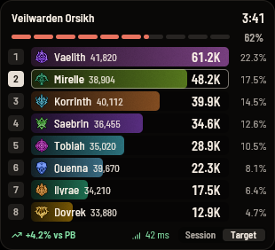
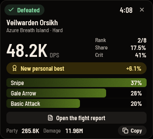
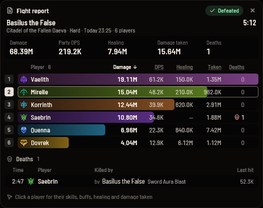
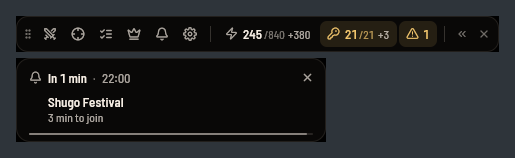
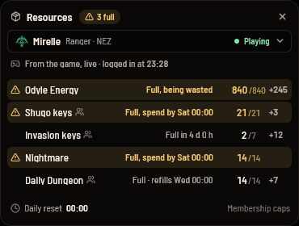
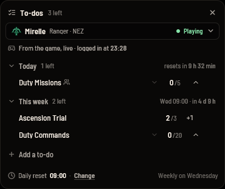

# Belisk

<p align="center">
  <a href="https://github.com/limonanthony/belisk-aion2-companion/actions/workflows/ci.yml"></a>
  
  <a href="https://github.com/zed-industries/zed/tree/main/crates/gpui"></a>
  
  
  <a href="./LICENSE"></a>
</p>

Belisk — combat meter and companion for AION 2, built for the global servers: a
small native overlay that shows who is dealing damage, live, and summarises boss
fights, with to-dos, resource counts and event reminders beside it.

Built from **[Aether](https://github.com/Helveticxa/Aether-Aion2-DPS-meter-Global)**
by Helveticxa, which is itself a fork of **[NOIA2](https://github.com/ZDYoung0519/NOIA2)**
by [zdyoung](https://github.com/ZDYoung0519). Thank you both. This project forked
Aether at version 2.4.0 (commit `d9f1d98`, 2026-09-24) and has been modified
since. It has no upstream now; the fork was only the starting point. The Rust
capture pipeline, the packet parsers and the game-data catalogues come from
them. Like both, it is
[GPL-3.0](./LICENSE).

> [!IMPORTANT]
> **Pre-release.** Nothing here has been confirmed against a long global
> session yet. Expect rough edges.

## Screenshots

Sample data: every name in these is invented.

<table>
  <tr>
    <td valign="top"><br>The Target board follows a boss until it dies: its HP, everyone's damage, and your pace against your personal best.</td>
    <td valign="top"><br>The kill summary: your DPS and place, top skills, and a new personal best.</td>
  </tr>
  <tr>
    <td colspan="2"><br>The fight report: damage, DPS, healing, damage taken and deaths for each player. Click a name for their skills and buffs.</td>
  </tr>
  <tr>
    <td colspan="2"><br>The toolbar keeps Odyle Energy and Shugo keys in view; reminders drop in below it before events start.</td>
  </tr>
  <tr>
    <td valign="top"><br>Resources, read from the game: what is full and about to go to waste.</td>
    <td valign="top"><br>To-dos for the day and the week, filled in from the game.</td>
  </tr>
</table>

## What it is

The meter reads combat data by **passively sniffing network packets**. It does
not read or write game memory, inject code, modify packets, or automate any part
of the game. It is a monitor.

- A floating, click-through overlay with class-coloured bars; Session board for
  the whole area and a Target board that follows a boss until it dies.
- A boss kill summary: your DPS and place, top skills, personal best.
- Finds the game, your character and the server on its own.
- English names for about 8,000 monsters and bosses. Runs fully offline.
- Alt+CapsLock locks the overlay; Alt+Shift+CapsLock shows or hides the toolbar
  and the open tools.

## What it never does

Anti-cheat watches what other programs do to the game. This meter is built so
there is nothing to find:

- It never injects code into a game, loads anything into it, or hooks its graphics.
  Switch the game to borderless to see the overlay.
- It never opens a game's process, reads or writes its memory, sends input, or
  automates anything.
- Packets are copied, never touched: Npcap, or WinDivert in sniff and
  receive-only mode. The WinDivert driver is loaded only when Npcap cannot
  capture, and unloaded when the meter is done with it.

None of this is a promise about terms of service. Whether a publisher allows a
third-party tool is its call.

## Requirements

- Windows 10 or 11.
- **Administrator**: packet capture requires it, and the exe asks for it.
- [Npcap](https://npcap.com/#download) is recommended. Without it the meter falls
  back to the bundled WinDivert driver (`WinDivert.dll` and `WinDivert64.sys`
  must stay beside the exe); with Npcap they are not needed.
- Start the meter before you log in to the game, so it can find your character.

## Run it

Build from source with the MSVC Rust toolchain:

```
cargo run --release -p belisk     # from an elevated terminal
cargo run -p belisk -- --replay <recording>   # replay a recording (.belisk, or .aetherpc from earlier builds)
cargo test --workspace
```

Settings (from the toolbar) has the switches "Collect mob data",
which records the mobs fought into `mobs.json`, and "Decision log", which
writes the meter's decisions to `belisk.log`. Both are off by default. Belisk
keeps its files in `%APPDATA%\Belisk` and `%LOCALAPPDATA%\Belisk\logs`; builds
before the rename used `com.helveticxa.aether` there, and the first launch moves
that folder over by itself.
[AGENTS.md](./AGENTS.md) has the layout and the gotchas;
[docs/technical-notes.md](./docs/technical-notes.md) explains how capture, parsing,
recording, saving, the overlay windows, distribution and the app's settings work.

## Credits

- Forked from **[Aether](https://github.com/Helveticxa/Aether-Aion2-DPS-meter-Global)**
  (version 2.4.0, 2026-09-24) by Helveticxa, itself a fork of
  **[NOIA2](https://github.com/ZDYoung0519/NOIA2)** by
  [zdyoung](https://github.com/ZDYoung0519): the Rust capture pipeline, packet
  parsers and game-data catalogues come from there.
- English monster and boss names, the Fighter's skill names and the server codes
  come from **[Kuroukihime/AIon2-Dps-Meter](https://github.com/Kuroukihime/AIon2-Dps-Meter)**
  (GPL-3.0), merged by `scripts/build-npc-names.mjs`.
- UI: [GPUI](https://github.com/zed-industries/zed/tree/main/crates/gpui); font
  Barlow Semi Condensed (OFL); icons from Lucide.

## Disclaimer

This tool reads network traffic on your own machine. It does not inject code,
modify memory, or alter game traffic, and it uploads nothing. It is still
third-party software: use it at your own discretion and in accordance with the
game's terms of service.

## License

[GPL-3.0-only](./LICENSE). Any distributed build must ship its source under the
same terms.
